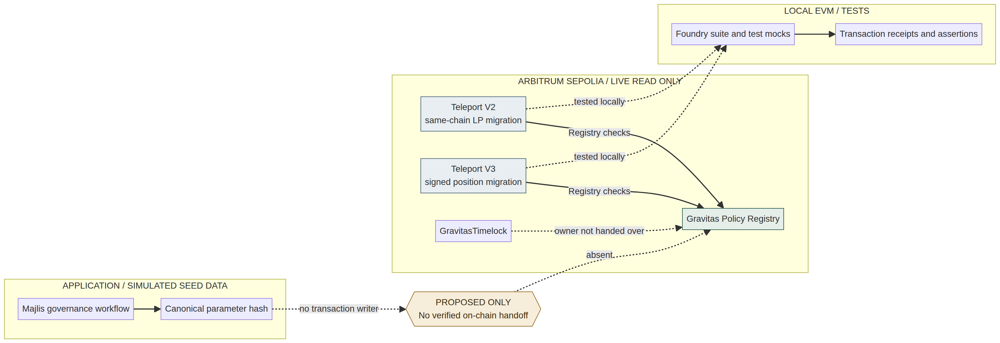
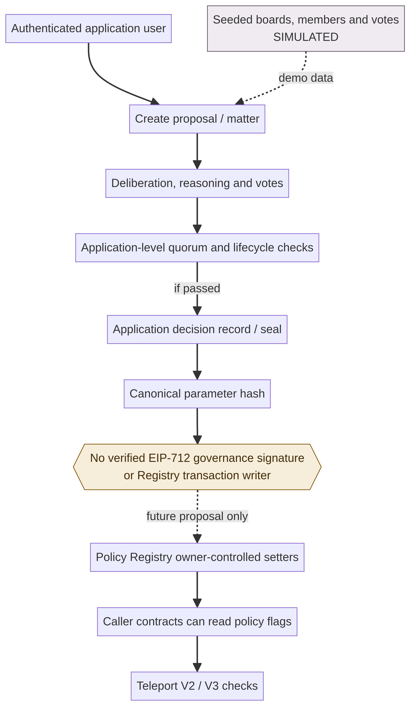
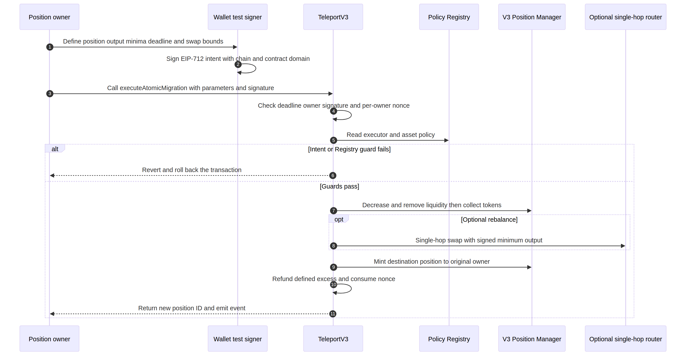
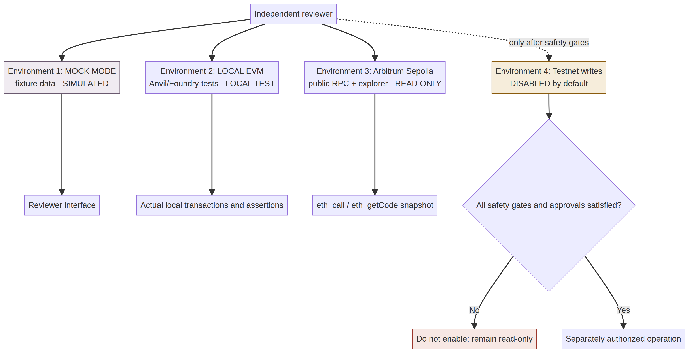

# Architecture and implementation boundaries

**Source baseline:** `692022e1ca34a280f90a198d2455ac3535b3bce2`.  
**Review label:** Internal technical review — not an independent security audit.

## Components

| Component | Observed implementation | What it does not prove |
|---|---|---|
| Majlis | Web application with authenticated proposal/matter routes, reasoning, votes, quorum calculation, objections, lifecycle and sealed application decision records. | It does not submit an on-chain Policy Registry write, and seeded records are not real institutional activity. |
| Parameter hash | Canonicalization and deterministic SHA-256 hash of parameters in `apps/majlis/server/src/services/hash.ts`. | A hash is not a signature, quorum result or Registry transaction. |
| Policy Registry | Owner-controlled asset, router and executor flags, pause state, policy history/version and policy hash. Callers can read these rules. | Registry state is not automatically enforced on arbitrary token transfers. Only integrated callers that invoke the checks are affected. |
| Teleport V2 | Same-chain constant-product LP migration through a configured factory/pair and authorized V2-compatible destination router, with Registry checks, cooldown and movement cap. | It is not a general-purpose bridge; no live V2 DEX route was established on Arbitrum Sepolia. |
| Teleport V3 | EIP-712-authorized, nonce/deadline-protected migration of a V3 position NFT into a newly minted position, with optional bounded single-hop rebalance. | It is not cross-chain and does not constitute a payment system. Repository tests use local mocks. |
| GravitasTimelock | OpenZeppelin-style timelock deployed on Arbitrum Sepolia with a live 300-second delay. | It is not the observed Registry/engine owner. Its existence does not demonstrate that it governs live policy changes. |
| Integration kit / SDK | Read/simulate/calldata helpers and a fixture-backed local JSON mock API. | The mock is not the deployed Registry; SDK does not submit transactions; OpenAPI security declaration is not implemented API authentication. |

## Current policy path

A Registry owner can update an allow-list flag and the contract advances a policy version/hash when a genuine change occurs. Teleport callers consult relevant Registry flags before a migration. If a check fails or the Registry is paused, the caller operation is rejected; if later work reverts, the enclosing EVM transaction's state changes revert. This applies only to code paths that query the Registry. No global token-transfer interceptor is present.

## Governance boundary

Majlis persists an application-level decision and hash; it does not turn that result into a verified cryptographic signature from an authorized Registry owner or a transaction to the deployed Registry. The diagram uses a dashed line for that absent handoff and labels any future bridge as proposed.

## Signature and execution boundary

Teleport V3's user intent is a separate mechanism from Majlis governance. It uses EIP-712 typed data and verifies the signature and owner, nonce, deadline and operation bounds on-chain. Local tests use test-only keys. The reviewer interface never requests a wallet or key and never sends a network transaction; its fixed T26/T27 actions execute local Foundry fixtures only.

## Environments

Mock-mode data is explicitly simulated. Local Foundry tests deploy deterministic mocks and exercise actual EVM execution. Arbitrum Sepolia views query existing deployed state read-only. The local reviewer runner accepts only two hard-coded test IDs; arbitrary commands and testnet writes remain disabled. Any future network-write environment requires a distinct authorization and safety review.

## Source map

- Registry: `contracts/GravitasPolicyRegistry.sol` and `test/foundry/PolicyCommitment.t.sol`.
- Timelock deployment/configuration: `contracts/governance/`, `script/DeployDeterministic.s.sol` and `script/TransferOwnershipToTimelock.s.sol`.
- V2: `contracts/TeleportV2.sol`, `test/foundry/TeleportV2FullFlow.t.sol`.
- V3: `contracts/TeleportV3.sol`, `test/foundry/TeleportV3FullFlow.t.sol`.
- Majlis: `apps/majlis/server/src/routes/`, `services/`, `data/seed*.ts` and `apps/majlis/server/test/`.
- SDK/mock integration: `gravitas-sdk/` and `integration-kit/`.
