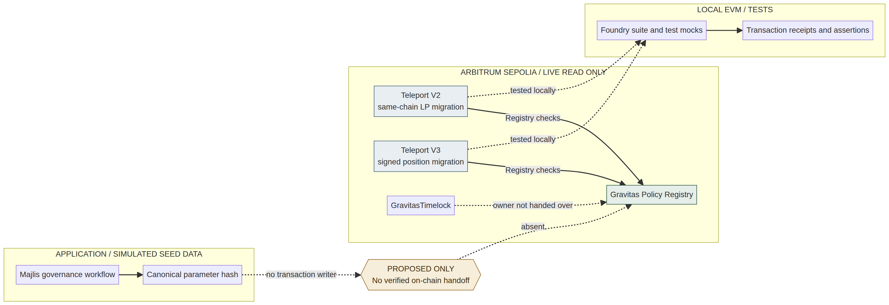

# Gravitas Protocol — Institutional Technical Evaluation

**Prepared for exploratory technical discussion with the Central Bank of the Republic of Azerbaijan**  
**Research and source cut-off:** 11 November 2026  
**Repository baseline:** `692022e1ca34a280f90a198d2455ac3535b3bce2`  
**Status:** Internal technical review — not an independent security audit.

## 1. Purpose and decision requested

Gravitas is exploring whether policy-aware execution, traceable application workflows and transaction evidence may be useful in a narrow, controlled digital-finance evaluation. This package asks for an exploratory technical review and guidance on the appropriate regulatory route. It does not ask for formal approval, a licence, procurement, funding, a sandbox place or a commitment by CBAR.

The present prototype can support source inspection, local unit/integration tests, local EVM execution with mocks and read-only observation of selected Arbitrum Sepolia contracts. It cannot demonstrate a production bank integration, the end-to-end execution of a Majlis-approved Registry change, live liquidity migration on the documented network, a complete identity/compliance service, an independent security audit or eligibility for a CBAR sandbox application.

## 2. Institutional problem hypothesis

Financial institutions and supervisors may need to make policy decisions traceable and to enforce defined transaction conditions consistently across technical execution. A software Registry can represent a bounded set of allow-list flags and versions; a caller contract can check those values before executing a defined action; events and receipts can make certain state changes easier to inspect.

This is a hypothesis for discussion, not a claim that CBAR has identified this problem for Gravitas, that the current system addresses the full control environment, or that on-chain records replace governance, legal responsibility, audit or regulated institutional controls.

## 3. System at a glance

Majlis is an application workflow. It records proposals, reasoning, votes and application lifecycle decisions; canonical parameter hashes provide data-integrity checks. The Registry separately holds owner-controlled asset/router/executor flags, pause state and a policy version/hash. Teleport V2/V3 caller contracts query the Registry and execute narrowly scoped same-chain liquidity operations. The live Timelock is a separate contract whose ownership has not been handed to the Registry or engines in the observed state.

The dotted Majlis-to-Registry edge is not implemented. A completed application vote does not create a verified Registry transaction. A hash is not a digital signature. The reviewer UI cannot send writes.

## 4. Source-backed implementation summary

### Majlis

The Majlis server has authenticated application routes and a real state machine for proposal/matter creation, deliberation, voting/quorum, objections and lifecycle progress, plus hashing/sealing and persistence adapters. Its seeded institutions, boards and records are fabricated demonstration data. Majlis has Registry read-side interfaces but no verified `writeContract`, signed authorization path or on-chain policy update flow. Its “in force” state is an application record only.

### Policy Registry

The Registry is an owner-controlled contract with asset, router and executor status, pause/unpause, current version, policy history/hash and compliance views. Only contracts that call the Registry can be gated by it; a flag is not a universal transfer restriction. The `subscriber` parameter of `checkSubscriptionCompliance` is not read. There is no KYC, AML/CFT identity check, sanctions screening, accreditation, suitability or investor-eligibility feature.

### Teleport V2

V2 performs a same-chain constant-product LP migration: resolve a pair through a supplied factory, burn LP, then add the same pair through an authorized V2 router. It checks executor/router/assets, cooldown and max movement, and returns defined dust. It does not bridge assets cross-chain, perform arbitrary swaps or send messages between networks. The repository says Arbitrum Sepolia has no usable V2 DEX route.

### Teleport V3

V3 verifies a signed EIP-712 intent and position owner, deadline and per-owner nonce; it removes/collects a V3 NFT position, optionally performs a bounded one-hop rebalance, mints a new position to the owner and refunds defined excess. Local tests use deterministic mocks. It does not preserve the same NFT token ID or provide cross-chain migration. Current issues include missing nonzero floors on decrease-side minima, no general rescue for directly received ERC-721s and no separate fast emergency pauser.

### SDK and mock API

The viem SDK reads/simulates/builds calldata rather than submitting wallet transactions. Its 20 unit tests and TypeScript build passed after updating the Zod dependency to 4.6.7. The integration-kit mock reads JSON fixtures and writes local JSONL logs; six scenarios returned the expected fixture decisions in a loopback-only run. It is not a hosted or production API. OpenAPI declares API-key security that the mock does not enforce. No live API/client integration was demonstrated; two high and two moderate advisories remain in SDK test/build dependencies.

## 5. Deployed state and access controls

At Arbitrum Sepolia block `328255709` (chain ID `421614`), read-only calls found runtime code at all four documented addresses. The Registry owner and both Teleport owners read as `0xFba6C221af564Ab90e333AEEf4E427f787911B73`; Registry pending owner is zero, paused is false, current version is 1, and policy history at version 1 reads `0x687a974ff8f6ad74a4ba4355e5502668cde3e41cb279579d7100251f6a54f43c`. V2/V3 are bound to that Registry. Teleport V3's own paused getter is false. Timelock minimum delay is 300 seconds; the observed owner has proposer role, does not have executor role, and the zero address does have executor role (open execution). This does not show that the Timelock governs Registry or engine ownership.

The official Arbitrum RPC endpoint returned HTTP 403 from this sandbox; reads used PublicNode, an identified third-party endpoint. Arbiscan exposes source and ABI panels for the addresses, but the bytecode was not proved equal to the exact repository commit and no second-provider agreement was captured. No write was sent.

## 6. Testing and failure semantics

On the base commit, Foundry format/build and all 86 root tests passed; Majlis typecheck, 56 test files/488 tests and build passed. The root build emitted an unused-parameter warning. After a local regression-test improvement, the targeted late V3 refund-failure test passed and explicitly compared source NFT owner/liquidity, user token balances and nonce to pre-call values. See [`CBAR_TEST_RESULTS.md`](CBAR_TEST_RESULTS.md) and the full 36-case [`CBAR_TEST_PLAN.md`](CBAR_TEST_PLAN.md).

The evidence demonstrates EVM rollback for the state fields asserted in a specific local mock failure path. It does not establish that every external dependency is safe or that atomicity removes smart-contract, market, oracle, liquidity, governance, legal or operational risk—or all gharar.

## 7. Potential use cases

Ten hypotheses—policy-controlled digital assets, traceable approvals, machine-readable policies, governance/auditability, controlled experiments, RegTech, operational risk, Shariah-conscious product governance, institution integration and tokenized-operation testing—are mapped in [`CBAR_REGULATORY_CONSIDERATIONS.md`](CBAR_REGULATORY_CONSIDERATIONS.md). Each distinguishes existing code from missing work, institutional dependencies, regulatory questions and what can be tested locally. None is presented as an existing customer use case or approved product.

## 8. Controlled evaluation proposal

A preliminary evaluation can be performed locally without customer assets: inspect source and ABI; run Foundry and Majlis tests; execute a success path; trigger a late failure; compare state; inspect test logs; and independently read a small set of public testnet getters. The reviewer guide provides a clean-checkout path. Any mock data must remain labelled simulated. No testnet writes are proposed for the initial review.

## 9. Regulatory and legal constraints

Gravitas currently has no Azerbaijan-registered legal entity. The third CBAR application window announced for 25 June–25 August 2026 has closed. The official portal says applications are received during windows announced by CBAR; no currently open cycle was evidenced in official sources reviewed by 11 November 2026. The sandbox is limited, supervised and agreement-based; it is not a licence, blanket waiver or endorsement. Applicant eligibility and local partner structure require current legal advice and CBAR guidance. This package is not a formal application.

## 10. Proposed next steps

1. Conduct a preliminary technical review of the local sandbox and evidence package.
2. Request exploratory guidance on relevant regulatory pathways and evidence expectations.
3. If there is independent interest, explore a local regulated financial institution as potential partner.
4. Determine an eligible Azerbaijan-registered applicant structure with local counsel.
5. Adapt the product, consumer, AML/CFT, privacy, cybersecurity, resilience, reporting and exit controls to a narrow use case.
6. Consider a future formally announced programme only when eligibility and readiness are demonstrated.

## Appendices

- [`PHASE1_REPOSITORY_AUDIT.md`](PHASE1_REPOSITORY_AUDIT.md)
- [`CBAR_ARCHITECTURE.md`](CBAR_ARCHITECTURE.md)
- [`CBAR_REVIEWER_GUIDE.md`](CBAR_REVIEWER_GUIDE.md)
- [`CBAR_EVIDENCE_INDEX.md`](CBAR_EVIDENCE_INDEX.md)
- [`CBAR_SECURITY_REVIEW.md`](CBAR_SECURITY_REVIEW.md)
- [`CBAR_KNOWN_LIMITATIONS.md`](CBAR_KNOWN_LIMITATIONS.md)
- [`research-sources.md`](research-sources.md)
